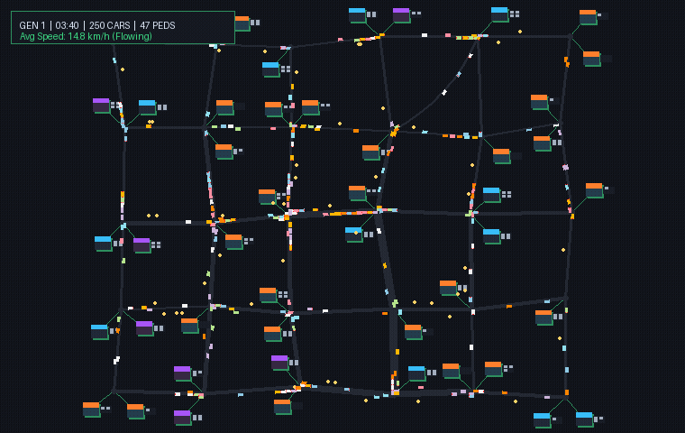

<div align="center">
  
  <h1>Ouroboros Traffic</h1>
  <p><strong>A self-perpetuating, zero-player traffic simulation and algorithmic city optimization experiment.</strong></p>

  [](https://www.rust-lang.org/)
  [](https://webassembly.org/)
  [](https://www.typescriptlang.org/)
  [](https://vitejs.dev/)
  [](https://developer.mozilla.org/en-US/docs/Web/API/Canvas_API)
</div>

---

## 📽 Simulation Preview

<div align="center">
  
  <p><em>Real simulation capture: Vehicles navigating roundabouts, pedestrians crossing zebra stripes, and lane-widened arterials.</em></p>
</div>

---

## 📖 The Idea

**Ouroboros Traffic** embodies the mythical serpent that consumes its own tail — an endless cycle of problem creation and resolution.

1. **Founding & Escalation**: The simulation starts with a modest settlement (4×3 grid) of residential, commercial, and civic buildings with parking lots and persistent citizens.
2. **Emergence of Jams**: As demand scales and the city dynamically expands, commuters and delivery traffic flood the road network, creating realistic bottlenecks and gridlock.
3. **The City Planner**: Once congestion exceeds critical thresholds, the automated planner triggers parallel **shadow simulations** that evaluate structural graph modifications (lane widening, roundabouts, and bypass roads).
4. **Resolution & Re-escalation**: If an intervention beats the "do nothing" baseline, it is permanently built into the road graph. Traffic flow is restored, demand climbs higher, and the cycle repeats with ever-greater complexity.

---

## 🚀 Quick Start (Run Locally)

### Prerequisites

- [Rust & Cargo](https://rustup.rs/) (edition 2024 / stable)
- [wasm-pack](https://rustwasm.github.io/wasm-pack/installer/) (`cargo install wasm-pack`)
- [Node.js](https://nodejs.org/) (v18+) & `npm`

### 1. Clone & Build WebAssembly

```bash
git clone https://github.com/bazavluk/ouroboros-traffic.git
cd ouroboros-traffic

# Compile the Rust core into WebAssembly
wasm-pack build --target web --release
```

### 2. Launch the Frontend

```bash
# Enter the UI directory and start the Vite dev server
cd ui
npm install
npm run dev
```

Open your browser at **`http://localhost:5173`**.

### 3. Headless Verification (Optional)

Run the full headless simulation loop and planner verification test in native Rust:
```bash
cargo test --release --test headless -- --nocapture
```

---

## 🛠 Tech Stack

- **Core Simulation Engine**: **Rust**
  - High performance, zero-cost abstractions, zero garbage collection pauses.
  - Complete simulation runs deterministically with a custom xorshift64* pseudo-random number generator for bit-for-bit cloneable shadow simulations.
- **Web Integration**: **wasm-bindgen** & **web-sys**
  - Seamless memory mapping and direct DOM / 2D Canvas context manipulation from WebAssembly.
- **Rendering**: **Pure HTML5 Canvas 2D API**
  - Lightweight, hardware-accelerated 2D pipeline rendering thousands of dynamic cars, pedestrians, buildings, and roads at 60 FPS without heavy external engines.
- **Frontend & HUD**: **TypeScript** + **Vite**
  - Real-time HUD showing traffic flow, velocity ratio, generation counter, live performance charts, and an interactive **City Chronicle** panel with click-to-focus navigation.

---

## 📐 Mathematical Models & Decision Formulas

### 1. Intelligent Driver Model (IDM) Car-Following

Vehicle acceleration $\dot{v} = \frac{\mathrm{d}v}{\mathrm{d}t}$ along each lane is governed by the microscopic continuous car-following model:

$$\dot{v} = a \left[ 1 - \left( \frac{v}{v_0} \right)^4 - \left( \frac{s^*(v, \Delta v)}{s} \right)^2 \right]$$

Where the dynamic desired safety headway $s^*(v, \Delta v)$ is computed as:

$$s^*(v, \Delta v) = s_0 + \max\left(0,\, v T + \frac{v \cdot \Delta v}{2\sqrt{a \cdot b}}\right)$$

| Symbol | Parameter | Value |
|---|---|---|
| $v_0$ | Desired free-flow speed | Edge limit $\times\, [0.85, 1.15]$ |
| $s_0$ | Minimum bumper-to-bumper distance at standstill | $2.0\,\text{m}$ |
| $T$ | Safe time headway | $1.3\,\text{s}$ |
| $a$ | Maximum comfortable acceleration | $1.6\,\text{m/s}^2$ |
| $b$ | Comfortable deceleration | $2.2\,\text{m/s}^2$ |
| $s$ | Current gap to lead vehicle / stop line | Measured in meters |
| $\Delta v$ | Approaching speed difference ($v - v_{\text{lead}}$) | $\text{m/s}$ |

---

### 2. Intersection Signals & Zebra Crosswalk Stopping

Vehicles calculate the stopping distance required under maximum braking $b_{\text{stop}} = 5.0\,\text{m/s}^2$:

$$d_{\text{stop}} = \frac{v^2}{2 \cdot b_{\text{stop}}}$$

A vehicle yields and stops ($s \leftarrow \text{distance to stop line}$) if:
1. The traffic signal phase is red:
   $$\text{phase} = (t + \phi_{\text{node}}) \pmod{28\,\text{s}}$$
   $$\text{Green}_{\text{horizontal}} = [0, 12)\,\text{s}, \quad \text{Green}_{\text{vertical}} = [14, 26)\,\text{s}$$
2. Or a pedestrian is currently on the crosswalk arm:
   $$\text{cross\_count}[e] > 0 \implies \text{Stop condition active}$$

---

### 3. Dynamic Congestion-Aware A* Routing

Edges represent directed road segments. The cost function $g(e)$ incorporates real-time travel speeds and intersection delays:

$$C_e = \frac{L_e}{\max(1.0,\, \min(v_{\max},\, v_{\text{tt}}))} + C_{\text{signal}}$$

Where:
- $L_e$ is the segment length (calculated via 16-segment numerical quadrature for Bézier curves).
- $v_{\text{tt}}$ is the exponential moving average of actual travel speed on edge $e$.
- $C_{\text{signal}} = 4.0\,\text{s}$ penalty if the target node is signalized.

The A* heuristic is admissible and Euclidean-consistent:

$$h(u, \text{dest}) = \frac{\sqrt{(x_u - x_{\text{dest}})^2 + (y_u - y_{\text{dest}})^2}}{v_{\text{global\_max}}}$$

---

### 4. Congestion Index & Exponential Moving Average (EMA)

At every sub-step, raw congestion on each edge is measured by velocity deficit combined with vehicle density:

$$\rho_e = \frac{N_e \cdot (L_{\text{car}} + s_0)}{L_e \cdot \text{lanes}_e}$$

$$\text{Jam}_{\text{raw}} = \left( 1 - \frac{\bar{v}_e}{v_{\max}} \right) \cdot \min(1.0,\, 2 \cdot \rho_e)$$

Smoothed via exponential moving average with time constant $\tau = 8.0\,\text{s}$:

$$\alpha = 1 - e^{-\Delta t / 8.0}$$
$$\text{Jam}_e(t) = \text{Jam}_e(t - \Delta t) + \alpha \cdot \left( \text{Jam}_{\text{raw}} - \text{Jam}_e(t - \Delta t) \right)$$

Node congestion $J_n$ balances peak arm jam and average incoming jam:

$$J_n = 0.6 \cdot \max_{e \in \text{in}(n)} \text{Jam}_e + 0.4 \cdot \frac{1}{|\text{in}(n)|} \sum_{e \in \text{in}(n)} \text{Jam}_e$$

---

### 5. Automated City Planner Decision Loop

#### Jam Trigger Threshold
The city triggers the optimization algorithm when congestion holds continuously for $t_{\text{hold}} = 8.0\,\text{s}$ under the adaptive condition:

$$\text{Threshold}_{\text{edges}} = \min\left(8,\, \max\left(3,\, \left\lfloor \frac{|\text{Edges}|}{6} \right\rfloor \right)\right)$$

$$\text{Jammed} \iff \left( N_{\text{jammed\_edges}} \ge \text{Threshold}_{\text{edges}} \;\land\; J_{\max} > 0.28 \right) \;\lor\; J_{\max} > 0.48$$

#### Shadow Simulation Scoring
The planner clones the world state into isolated shadow sandboxes and simulates each candidate alongside a "do nothing" baseline for $T_{\text{shadow}} = 40\,\text{s}$:

$$\text{Score} = (A - A_0) + 150 \cdot \bar{R}_v - 0.3 \cdot N_{\text{jam}} - 0.6 \cdot (B - B_0) - 2.0 \cdot (R - R_0) - 0.4 \cdot |V|$$

Where:
- $A - A_0$: Trips successfully arrived during shadow horizon.
- $\bar{R}_v$: Mean velocity ratio $\frac{\bar{v}}{v_0}$ across the fleet.
- $B - B_0$: Blocked trip departures due to queue spillback.
- $R - R_0$: Teleported / gridlocked vehicles rescued.
- $|V|$: Total remaining vehicles in transit.

#### Acceptance Criterion
A modification is permanently executed on the live graph if and only if:

$$\text{Score}_{\text{best}} > \text{Score}_{\text{baseline}} + \max(1.5,\, 0.01 \cdot |\text{Score}_{\text{baseline}}|)$$

If no candidate beats the baseline, demand is throttled by 15% ($\text{spawn\_rate} \leftarrow 0.85 \cdot \text{spawn\_rate}$) to let queues discharge.

---

### 6. City Expansion & Metropolis Boundary Limit

The city starts on a $4 \times 3$ grid and automatically grows outward in alternating directions until reaching its metropolis boundaries:

$$W_{\max} = 12, \quad H_{\max} = 8, \quad N_{\max} = 96 \text{ nodes}$$

$$\text{CanExpand} \iff (W < 12 \lor H < 8) \land |\text{Nodes}| < 96$$

Once the boundary is reached, territorial expansion ceases and all future interventions focus purely on topological throughput optimization (lanes, roundabouts, and bypass arteries).

---

## 🎮 Controls & Interface

| Control | Action |
|---|---|
| **Space** | Pause / Resume simulation |
| **Speed Buttons** | Switch simulation speed ($\times 1$, $\times 5$, $\times 10$) |
| **Congestion Checkbox** | Toggle real-time heatmap rendering on road segments |
| **Nodes Checkbox** | Display graph node IDs |
| **Paths Checkbox** | Render live A* vehicle routes and destinations |
| **AI Planner Checkbox** | Enable / disable automatic city planner optimizations |
| **Reset View** | Re-center camera over the current city boundary |
| **New City** | Generate a fresh randomized settlement |
| **Mouse Drag** | Pan canvas |
| **Mouse Wheel** | Smooth zoom in / out centered at cursor |
| **City Chronicle (Right)** | Click any update card to focus and highlight the change on the map |

---

## 📄 License

This project is licensed under the [MIT License](LICENSE) © 2026 **Ruslan Bazavluk**. All rights reserved.
